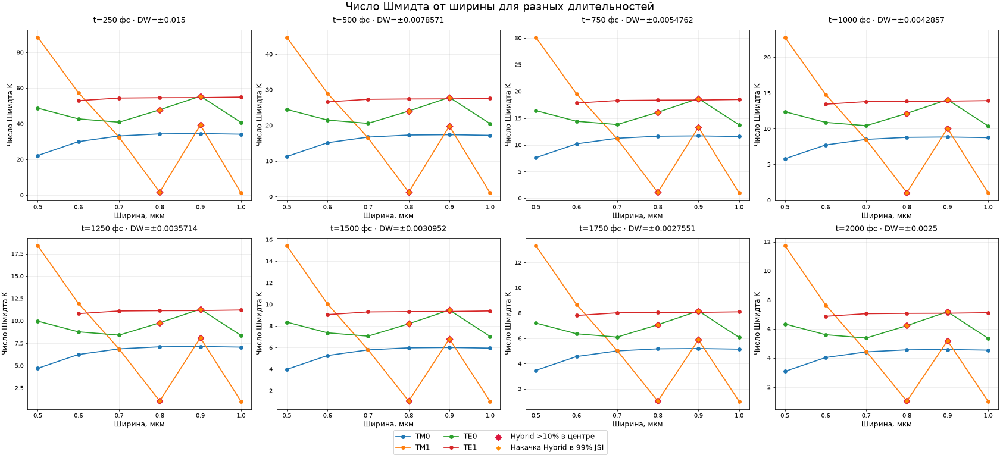

<p align="center">
  
</p>

<p align="center">
  <strong>От комплексных полей волновода — к совместному спектру фотонной пары.</strong><br>
  LiNbO₃ · COMSOL · Python · пространственные моды · дисперсия · JSI · число Шмидта
</p>

---

Исследовательский проект для расчёта мод волноводов на ниобате лития и спектральных свойств спонтанного параметрического рассеяния (SPDC). COMSOL рассчитывает комплексные векторные поля и эффективные показатели преломления; Python отслеживает физические ветви, аппроксимирует дисперсию и вычисляет JSI и число Шмидта **K**.

**В репозитории:** исходный код, сценарии исследований, ноутбук просмотра, компактная модель COMSOL, таблицы материалов и примеры графиков. Карты полей COMSOL хранятся локально. Текущие сценарии сохраняют компактные превью JSA и JSI.

[Быстрый старт](#быстрый-старт) · [Рабочий процесс](docs/workflow.md) · [Как считается](#как-считается) · [Хранение](#хранение-результатов) · [Тесты](#тесты)

## Что умеет проект

- Рассчитывать серии ширин и длин волн в COMSOL, сохраняя **комплексные Ex, Ey, Ez**, координаты и n_eff.
- Отбирать решения по потерям и отслеживать моды по перекрытию полей, а не по порядку n_eff.
- Классифицировать центральные профили как **TE0, TE1, … / TM0, TM1, …** и отмечать смешанную поляризацию.
- Аппроксимировать Re(n_eff) полиномом по **ω**, показывать первые две производные и выбирать степень 1–6.
- Вычислять **JSA, JSI и K** для серии длительностей накачки 250–2000 фс.
- Получать нормированные спектры signal/idler по ω и λ, учитывать якобиан и подписывать **FWHM**.
- Проверять гибридизацию накачки в интервале, формирующем выбранную долю JSI.
- Использовать готовый кэш для повторного просмотра графиков, без повторного SVD.

## Примеры результатов

**K от ширины волновода.** Каждая панель соответствует своей длительности импульса; линии обозначают пространственные моды накачки.



**K от длительности импульса.** Каждая панель соответствует своей ширине. Красные ромбы показывают гибридизацию в центральной точке; маленькие оранжевые — гибридизацию накачки в её спектральном интервале.


Это примеры сохранённого расчёта, а не универсальные характеристики всех LNOI-волноводов. Результат зависит от геометрии, выбранных мод, длины взаимодействия, дисперсии, окна и разрешения сетки.

## Быстрый старт

### 1. Подготовить окружение

Нужны **Python ≥ 3.11** и установленная совместимая **COMSOL Multiphysics** с лицензией на физику используемой модели. COMSOL не входит в репозиторий. Для запуска решателя из Python дополнительно нужны `MPh` и `JPype1`.

Скачайте репозиторий и откройте терминал **в его корневой папке**:

```powershell
python -m venv .venv
.\.venv\Scripts\python.exe -m pip install -r requirements.txt
.\.venv\Scripts\python.exe -m pip install MPh JPype1
```

На Linux/macOS используйте `.venv/bin/python` вместо `.\.venv\Scripts\python.exe`. Установку и обнаружение COMSOL на конкретной системе нужно проверить отдельно.

### 2. Рассчитать исходные поля

Ширины, диапазоны длин волн, число точек, сетка полей и число ядер задаются в [`run_config_comsol.json`](run_config_comsol.json).

```powershell
.\.venv\Scripts\python.exe -m linbo3 --config run_config_comsol.json
```

COMSOL сохраняет таблицы в `results/comsol/`, а карты полей — в `field_maps/`.
Явный флаг `--stage comsol` также поддерживается. Анализ запускается отдельно
через Python-сценарии.

После прерывания повторите ту же команду. Для готовой пары «ширина × диапазон»
проверяется SHA-256 карты, а недостающий CSV восстанавливается из кэша.
Повреждённая карта пересчитывается при запуске COMSOL. При чтении из исследования
такая пара попадает в диагностику. Два запроса к одной карте используют общий
кэш, а повторный запуск того же прогона во время его работы отклоняется.

### 3. Запустить исследование

```powershell
.\.venv\Scripts\python.exe -m studies.fit_effect
.\.venv\Scripts\python.exe -m studies.unclassified
.\.venv\Scripts\python.exe -m studies.spatial_single
.\.venv\Scripts\python.exe -m studies.pulse_series
```

Настройки и последовательность действий задаются в каждом сценарии Python.
По умолчанию выбирается последний завершённый COMSOL-прогон. Используйте
`--comsol-run <имя-папки>` или `--comsol-dir <путь>`, чтобы указать конкретные данные.
Флаг `--results-root <путь>` задаёт каталог отчётов и кэша.
Для нового исследования добавьте модуль в studies/. Функция run принимает
каталог исходных данных и корень результатов. Контекст publish_study
предоставляет временную папку для отчёта, а cache_root указывает библиотечным
расчётам, где хранить общие случаи SPDC.
Для быстрой проверки используйте `--points 101`. Все сценарии читают сохранённые поля COMSOL.
Готовая пара конфигурации и сценария для серии 0,4–0,7 мкм описана в [руководстве](docs/workflow.md#запуск-исследования).

### 4. Открыть отчёт

Откройте `LiNbO3 — расчёт волноводов.ipynb` из корня проекта и задайте `STUDY`.
Ноутбук читает сводку и графики из постоянной папки исследования и строит превью
JSI и фазы JSA для выбранной строки. [Описание и оригиналы исследований](legacy/README.md).
[Сохранённые отчёты по серии 0,4–0,7 мкм](results/README.md) доступны для просмотра из клона.

## Как считается

### Отбор и физические ветви

На каждой точке используется строгий критерий `abs(Im(n_eff)) < IMAG_LIMIT`; по умолчанию `IMAG_LIMIT = 1e-6`. Поля должны быть конечными и ненулевыми. Моды отслеживаются по перекрытию комплексных векторных полей с контролем `MIN_OVERLAP` и запаса `MIN_MARGIN` относительно альтернативной ветви.

Центральные длины волн по умолчанию — **775 нм** для накачки и **1550 нм** для signal/idler. Номер пространственного порядка равен числу боковых пиков доминирующей компоненты минус один. TE/TM — квазиполяризационные метки для принятой геометрии поперечного сечения; смешанная мода сохраняет признак **Hybrid**. Порог примеси второй поперечной поляризации — строго больше 10%.

В пространственном сценарии выбираются signal **TM0** и idler **TE0**. Ширины с более чем двумя допустимыми центральными IS-модами исключаются из JSI/K. Эти ограничения относятся к текущему сценарию, а не ко всем возможным процессам SPDC.

### Дисперсия, JSI и K

Рабочая аппроксимация — полином **Re(n_eff)(ω)**, по умолчанию шестой степени. Степень 1–6 задаётся в выбранном сценарии. `fit_effect` сравнивает все шесть. Частота ω измеряется в **рад/фс**, λ — вакуумная длина волны.

Рассчитывается комплексная JSA с гауссовой огибающей накачки и sinc-функцией фазового согласования; **JSI = |JSA|²**. После SVD комплексной JSA:

$$p_j=\frac{\sigma_j^2}{\sum_k\sigma_k^2},\qquad K=\frac{1}{\sum_j p_j^2}.$$

K характеризует спектральные моды Шмидта выбранной фотонной пары; это не количество пространственных мод COMSOL. Заданная `t_fs` используется как длительность FWHM в принятой гауссовой модели. Длина взаимодействия берётся из настроек, а при её отсутствии используется 0,12 м.

### Спектры и гибридизация

Маргинальные спектры получаются суммированием полной JSI по второй частотной оси. При переходе к λ используется

$$S_\lambda=S_\omega\left|\frac{d\omega}{d\lambda}\right|,\qquad \left|\frac{d\omega}{d\lambda}\right|=\frac{2\pi c}{\lambda^2}.$$

Каждый спектр нормируется на собственный максимум **после** преобразования координат. FWHM вычисляется отдельно для каждой оси с интерполяцией пересечений половинной высоты; для раздельных пиков берётся связная область главного максимума. Если пересечение выходит за сетку, ширина не объявляется измеренной.

Для дополнительной проверки накачки суммируются антидиагонали JSI с постоянным **ωp = ωs + ωi**. Центральный интервал по дискретным квантилям содержит не менее `SPECTRAL_FRACTION = 0.99` вклада. В его пределах проверяются сохранённые поля **той же отслеженной ветви накачки**. Проверка не интерполирует поляризацию между точками COMSOL: единственная точка в интервале подтверждает только её собственное состояние.

## Настройки исследования

- `run_config_comsol.json` задаёт ширины, сетки длин волн, размер сетки полей, число ядер и геометрию.
- `studies/fit_effect.py` задаёт источник данных, методы аппроксимации, выбор мод, длительность и частотную сетку.
- Параметры классификации и гибридизации задаются в Python-сценариях пространственных исследований.

При увеличении частотного окна с тем же числом точек шаг становится крупнее,
поэтому нужно проверять сходимость K. `border_fraction` помогает заметить
отсечение краями окна. За пределы исходных диапазонов COMSOL дисперсия не
экстраполируется.

## Хранение результатов

```text
results/
  comsol/<прогон>/          параметры и CSV n_eff со ссылками на карты
  cases/<случай>/          превью JSI/JSA, точные проекции и метрики
  studies/<имя>/          последний успешно подготовленный отчёт исследования
field_maps/<подпись>/      комплексные поля COMSOL, параметры и журнал (вне Git)
jsa_full/<случай>/         полные JSA от старых запусков (вне Git)
```

Имя карты поля содержит ширину, диапазон, число длин волн и размер сетки.
JSON рядом с картой фиксирует полный список длин волн, геометрию и хеши модели
и таблиц материалов. Результаты разных COMSOL-прогонов могут ссылаться на
одну карту. Аналогично разные исследования могут ссылаться на один численный
случай SPDC, если совпадают входные ветви, фиты и параметры расчёта.
Каждый рассчитанный случай сохраняется сразу. Отчёт заменяется целиком после
успешной обработки. При прерывании предыдущий отчёт остаётся доступен,
а повторный запуск использует готовые случаи. Файл settings.json фиксирует
фактические настройки, сводка содержит ключи случаев и относительные пути к NPZ.

Публичный NPZ содержит превью JSI и комплексной JSA до 129 × 129. Число
Шмидта, веса, маргинальные спектры и распределение суммы частот рассчитаны
на полной сетке. Эти проекции позволяют считать FWHM и проверять
гибридизацию без повторного SPDC. Для анализа произвольных элементов
полных матриц нужно повторить SPDC на той же сетке.

Из корня проекта можно проверить и уплотнить старые случаи:

```powershell
python -m linbo3.compact_cases
python -m linbo3.compact_cases --apply
```

Первая команда показывает оценку, вторая проверяет и атомарно заменяет
старые NPZ, сохраняя их имена и ключи. Старые полные JSA можно убрать отдельным
запуском `python -m linbo3.compact_cases --remove-full-jsa`.
Он удаляет только архивы с соответствующей проверенной компактной копией.

## Структура кода

| Модули | Назначение |
|---|---|
| `pipeline.py`, `comsol.py` | COMSOL, локальные материалы, извлечение полей и продолжение расчёта |
| `modes.py`, `saved_modes.py` | Отбор и отслеживание решений, аудит сохранённых данных |
| `mode_classification.py` | Пространственные профили, поляризация и метки |
| `interpolation.py`, `polynomial.py` | Полиномы по ω и организация аппроксимации |
| `spdc.py`, `sweep.py` | JSA, JSI, SVD и K |
| `case_cache.py`, `artifacts.py`, `study_output.py` | Кэш случаев и публикация отчётов |
| `spectral_projections.py`, `compact_cases.py` | Точные проекции JSI и уплотнение старых случаев |
| `spatial_workflow.py`, `pulse_series.py` | Пространственное отслеживание, один импульс и графики серии |
| `marginal_spectra.py`, `pump_hybridization.py` | Спектры, FWHM и спектральный аудит накачки |
| `interpolation_study.py`, `single_degree.py` | Сравнение полиномов и прежний сценарий |
| `storage.py` | Хранение результатов прежних ноутбуков |

Модель: `god_save_me_compact.mph`. Таблицы: `n_SiO2.txt`, `no_LiNbO3.txt`, `ne_LiNbO3.txt`. При загрузке через Python модель получает относительные имена этих локальных файлов вместо исторических адресов из MPH.

## Тесты

```powershell
python -m unittest discover -s tests -p "test_*.py"
```

Тесты проверяют математические формулы, классификацию, отслеживание ветвей, якобиан и FWHM, чтение из кэша, проверку гибридизации, раздельное хранение исследований и возобновление из кэша. В тестах решатель COMSOL подменяется: они не требуют лицензии COMSOL и не заменяют проверку полного физического расчёта на конкретной установке.

GitHub Actions запускает Python-тесты при push и pull request. Для доработок полезно сохранять проверку «просмотр из кэша не вызывает расчёт JSI/SVD» и публикацию отчёта после успешного завершения.

## Лицензия

Код и документация распространяются по [MIT License](LICENSE). COMSOL Multiphysics — отдельное проприетарное программное обеспечение, для его использования нужна соответствующая лицензия.
