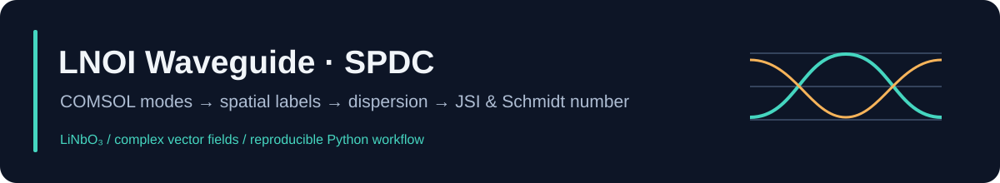
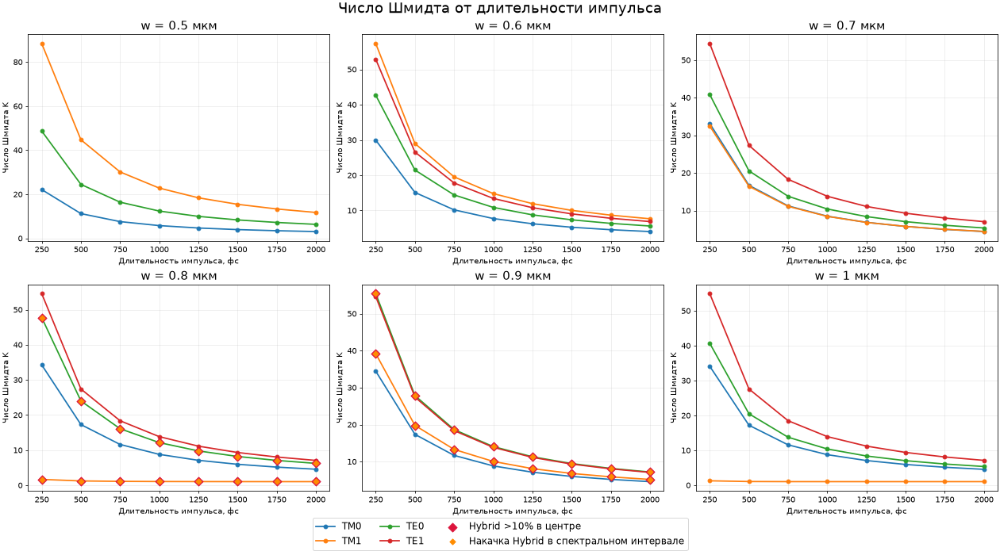

<p align="center">
  
</p>

<p align="center">
  <strong>От комплексных полей волновода — к совместному спектру фотонной пары.</strong><br>
  LiNbO₃ · COMSOL · Python · пространственные моды · дисперсия · JSI · число Шмидта
</p>

---

Исследовательский проект для расчёта мод волноводов на ниобате лития и спектральных свойств спонтанного параметрического рассеяния (SPDC). COMSOL рассчитывает комплексные векторные поля и эффективные показатели преломления; Python отслеживает физические ветви, аппроксимирует дисперсию и вычисляет JSI и число Шмидта **K**.

**В репозитории:** исходный код, четыре ноутбука, компактная модель COMSOL, таблицы материалов и два примера графиков. Многогигабайтные результаты и кэши не включены — их можно получить локально.

[Быстрый старт](#быстрый-старт) · [Ноутбуки](#ноутбуки) · [Как считается](#как-считается) · [Хранение](#хранение-результатов) · [Тесты](#тесты)

## Что умеет проект

- Рассчитывать серии ширин и длин волн в COMSOL, сохраняя **комплексные Ex, Ey, Ez**, координаты и n_eff.
- Отбирать решения по потерям и отслеживать моды по перекрытию полей, а не по порядку n_eff.
- Классифицировать центральные профили как **TE0, TE1, … / TM0, TM1, …** и отмечать смешанную поляризацию.
- Аппроксимировать Re(n_eff) полиномом по **ω**, показывать первые две производные и выбирать степень 1–6.
- Вычислять **JSA, JSI и K** для серии длительностей накачки 250–2000 фс.
- Получать нормированные спектры signal/idler по ω и λ, учитывать якобиан и подписывать **FWHM**.
- Проверять гибридизацию накачки в интервале, формирующем выбранную долю JSI.
- Использовать готовый кэш для повторного просмотра графиков, без повторного SVD.

## Примеры результатов

**K от ширины волновода.** Каждая панель соответствует своей длительности импульса; линии обозначают пространственные моды накачки.


**K от длительности импульса.** Каждая панель соответствует своей ширине. Красные ромбы показывают гибридизацию в центральной точке; маленькие оранжевые — гибридизацию накачки в её спектральном интервале.



Это примеры сохранённого расчёта, а не универсальные характеристики всех LNOI-волноводов. Результат зависит от геометрии, выбранных мод, длины взаимодействия, дисперсии, окна и разрешения сетки.

## Быстрый старт

### 1. Подготовить окружение

Нужны **Python ≥ 3.11** и установленная совместимая **COMSOL Multiphysics** с лицензией на физику используемой модели. COMSOL не входит в репозиторий. Для запуска решателя из Python дополнительно нужны `MPh` и `JPype1`.

Скачайте репозиторий и откройте терминал **в его корневой папке**:

```powershell
python -m venv .venv
.\.venv\Scripts\python.exe -m pip install -r requirements.txt
.\.venv\Scripts\python.exe -m pip install MPh JPype1
```

На Linux/macOS используйте `.venv/bin/python` вместо `.\.venv\Scripts\python.exe`. Установку и обнаружение COMSOL на конкретной системе нужно проверить отдельно.

### 2. Рассчитать исходные поля

Ширины, диапазоны длин волн, число точек, сетка полей и число ядер задаются в [`run_config_comsol.json`](run_config_comsol.json).

```powershell
.\.venv\Scripts\python.exe -m linbo3 --stage comsol --config run_config_comsol.json
```

Программа создаст `results_comsol/current/`. Если расчёт прервался, повторите команду: корректные неизменившиеся диапазоны можно использовать из кэша.

### 3. Открыть главный ноутбук

```powershell
.\.venv\Scripts\python.exe -m jupyterlab
```

Откройте **[LiNbO3 — расчёт волноводов.ipynb](LiNbO3%20%E2%80%94%20%D1%80%D0%B0%D1%81%D1%87%D1%91%D1%82%20%D0%B2%D0%BE%D0%BB%D0%BD%D0%BE%D0%B2%D0%BE%D0%B4%D0%BE%D0%B2.ipynb)** и выполняйте ячейки сверху вниз. Ядро должно использовать установленное окружение; рабочая папка ядра — корень проекта.

> Сам ноутбук не запускает COMSOL. При пустой папке результатов сначала выполните шаг 2. Опубликованные ноутбуки очищены от вывода; обзорные примеры находятся в `docs/images/`.

## Ноутбуки

| Вариант | Для чего | Профиль данных Python |
|---|---|---|
| **Главный** `LiNbO3 — расчёт волноводов.ipynb` | Пространственная классификация, одна выбранная степень, серия импульсов, спектры и гибридизация | `main/` |
| `… — сравнения полиномов.ipynb` | Сравнение полиномиальных степеней | `comparison/` |
| `… —одна длительность импульса.ipynb` | Пространственный расчёт для одной длительности | `single_pulse/` |
| `… — без классификации по модам.ipynb` | Ранее использовавшийся вариант без пространственных меток | `unclassified/` |

Профиль выбирается в разделе 1. Для разных ноутбуков удобнее использовать отдельные ядра. При переключении обязательно выполните раздел 1 нужного ноутбука.

### Маршрут главного ноутбука

| Раздел | Результат |
|---|---|
| **1–2** | Выбор проекта и загрузка текущих полей COMSOL |
| **3–3.1** | Re/Im(n_eff), отбор, отслеживание, центральные профили и пространственные метки |
| **4** | Полином по ω и две производные; степень задаётся явно |
| **5** | JSI и K при 2000 фс |
| **5.1** | Спектры signal/idler по ω и λ с FWHM |
| **5.2** | Проверка гибридизации накачки по её интервалу суммы частот |
| **6** | K от ширины |
| **7** | Серия 250, 500, 750, 1000, 1250, 1500, 1750, 2000 фс; K(w) в сетке 2×4 и K(t) в сетке 2×3 |
| **7.1** | Просмотр выбранных JSI и спектров из кэша; пример — 250 фс |

## Как считается

### Отбор и физические ветви

На каждой точке используется строгий критерий `abs(Im(n_eff)) < IMAG_LIMIT`; по умолчанию `IMAG_LIMIT = 1e-6`. Поля должны быть конечными и ненулевыми. Моды отслеживаются по перекрытию комплексных векторных полей с контролем `MIN_OVERLAP` и запаса `MIN_MARGIN` относительно альтернативной ветви.

Центральные длины волн по умолчанию — **775 нм** для накачки и **1550 нм** для signal/idler. Номер пространственного порядка равен числу боковых пиков доминирующей компоненты минус один. TE/TM — квазиполяризационные метки для принятой геометрии поперечного сечения; смешанная мода сохраняет признак **Hybrid**. Порог примеси второй поперечной поляризации — строго больше 10%.

В пространственном сценарии выбираются signal **TM0** и idler **TE0**. Ширины с более чем двумя допустимыми центральными IS-модами исключаются из JSI/K. Эти ограничения относятся к текущему сценарию, а не ко всем возможным процессам SPDC.

### Дисперсия, JSI и K

Рабочая аппроксимация — полином **Re(n_eff)(ω)**, по умолчанию шестой степени. `POLYNOMIAL_DEGREE` позволяет выбрать степень 1–6. Частота ω измеряется в **рад/фс**, λ — вакуумная длина волны.

Рассчитывается комплексная JSA с гауссовой огибающей накачки и sinc-функцией фазового согласования; **JSI = |JSA|²**. После SVD комплексной JSA:

$$p_j=\frac{\sigma_j^2}{\sum_k\sigma_k^2},\qquad K=\frac{1}{\sum_j p_j^2}.$$

K характеризует спектральные моды Шмидта выбранной фотонной пары; это не количество пространственных мод COMSOL. Заданная `t_fs` используется как длительность FWHM в принятой гауссовой модели. Длина взаимодействия берётся из настроек, а при её отсутствии используется 0,12 м.

### Спектры и гибридизация

Маргинальные спектры получаются суммированием полной JSI по второй частотной оси. При переходе к λ используется

$$S_\lambda=S_\omega\left|\frac{d\omega}{d\lambda}\right|,\qquad \left|\frac{d\omega}{d\lambda}\right|=\frac{2\pi c}{\lambda^2}.$$

Каждый спектр нормируется на собственный максимум **после** преобразования координат. FWHM вычисляется отдельно для каждой оси с интерполяцией пересечений половинной высоты; для раздельных пиков берётся связная область главного максимума. Если пересечение выходит за сетку, ширина не объявляется измеренной.

Для дополнительной проверки накачки суммируются антидиагонали JSI с постоянным **ωp = ωs + ωi**. Центральный интервал по дискретным квантилям содержит не менее `SPECTRAL_FRACTION = 0.99` вклада. В его пределах проверяются сохранённые поля **той же отслеженной ветви накачки**. Проверка не интерполирует поляризацию между точками COMSOL: единственная точка в интервале подтверждает только её собственное состояние.

## Настройки исследования

| Где | Параметры |
|---|---|
| `run_config_comsol.json` | `widths_um`, диапазоны и число длин волн, `field_grid`, `cores`, геометрия |
| Раздел 3 | `IMAG_LIMIT`, `MIN_OVERLAP`, `MIN_MARGIN`, выбор опорных решений |
| Раздел 4 | `POLYNOMIAL_DEGREE` |
| Раздел 5.2 | `SPECTRAL_FRACTION`, `MIXING_LIMIT` |
| Раздел 7 | `PULSE_WINDOWS`, `PULSE_POINTS`, размеры и DPI графиков |
| Раздел 7.1 | Выбор длительности и включение JSI/маргинальных спектров |

Начальная таблица DW линейна по 1/t между **±0,015 рад/фс при 250 фс** и **±0,0025 рад/фс при 2000 фс**. Её можно изменить в ячейке. При увеличении окна с тем же числом точек шаг становится крупнее — нужно проверять сходимость K. Контроль `border_fraction` обнаруживает отсечение краями окна, но не заменяет проверку разрешения. За пределы исходных диапазонов COMSOL дисперсия не экстраполируется.

## Хранение результатов

```text
results_comsol/                       # создаётся локально, исключён из Git
└── current/                          # один текущий набор COMSOL
    ├── config.json, status.json
    ├── w_0.5/                        # комплексные поля, n_eff и метаданные кэша
    ├── w_…/
    └── analysis/
        ├── main/
        │   ├── mode_classification/
        │   ├── mode_diagnostics_poly6/
        │   ├── spatial/              # текущий расчёт 2000 фс
        │   └── pulses/t_250fs/ …     # текущие случаи серии
        ├── comparison/
        ├── single_pulse/
        └── unclassified/
```

**Хранение работает с заменой прежних результатов, а не с накоплением истории.**

- Одинаковые параметры позволяют использовать корректный кэш.
- Изменившиеся поля COMSOL перезаписываются; удалённые ширины убираются.
- Изменение конфигурации COMSOL очищает производные результаты Python всех профилей.
- Изменение степени, DW или размера сетки заменяет данные соответствующего метода. После успешного расчёта прежние варианты его матриц удаляются.
- Длительности одной серии — отдельные необходимые случаи. Удалённые из серии длительности очищаются.
- После прерывания незавершённый результат не считается актуальным.

Чтобы сохранить независимую историю исследования, заранее сделайте отдельную копию проекта. Внутренние пути переносимы вместе с папкой; после переноса перезапустите ядро.

## Структура кода

| Модули | Назначение |
|---|---|
| `pipeline.py`, `comsol.py` | COMSOL, локальные материалы, извлечение полей и продолжение расчёта |
| `modes.py`, `saved_modes.py` | Отбор и отслеживание решений, аудит сохранённых данных |
| `mode_classification.py` | Пространственные профили, поляризация и метки |
| `interpolation.py`, `polynomial.py` | Полиномы по ω и организация аппроксимации |
| `spdc.py`, `sweep.py` | JSA, JSI, SVD, K и численный кэш |
| `spatial_workflow.py`, `pulse_series.py` | Главный сценарий и серия импульсов |
| `marginal_spectra.py`, `pump_hybridization.py` | Спектры, FWHM и спектральный аудит накачки |
| `interpolation_study.py`, `single_degree.py` | Сравнение полиномов и прежний сценарий |
| `storage.py` | Профили ноутбуков и очистка текущих результатов |

Модель: `god_save_me_compact.mph`. Таблицы: `n_SiO2.txt`, `no_LiNbO3.txt`, `ne_LiNbO3.txt`. При загрузке через Python модель получает относительные имена этих локальных файлов вместо исторических адресов из MPH.

## Тесты

```powershell
python -m unittest discover -s tests -p "test_*.py"
```

Тесты проверяют математические формулы, классификацию, отслеживание ветвей, якобиан и FWHM, чтение из кэша, проверку гибридизации и хранение с перезаписью. В тестах решатель COMSOL подменяется: они не требуют лицензии COMSOL и не заменяют проверку полного физического расчёта на конкретной установке.

GitHub Actions запускает Python-тесты при push и pull request. Для доработок полезно сохранять проверку «просмотр из кэша не вызывает расчёт JSI/SVD» и изоляцию профилей хранения.

## Лицензия

Код и документация распространяются по [MIT License](LICENSE). COMSOL Multiphysics — отдельное проприетарное программное обеспечение, для его использования нужна соответствующая лицензия.
